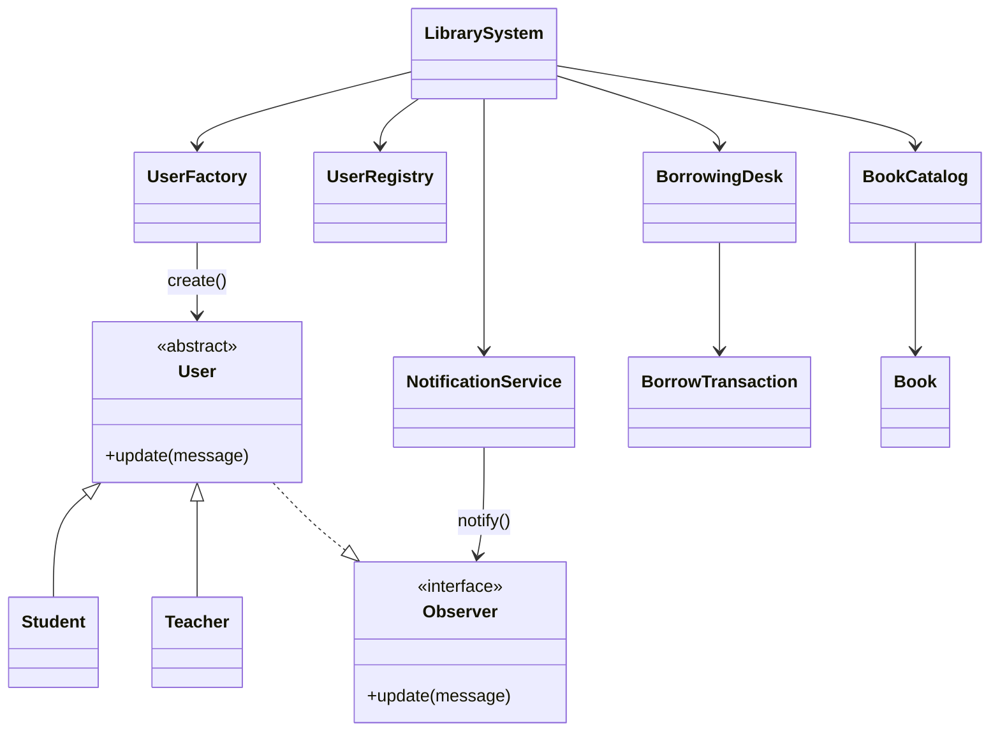

# Système de gestion de bibliothèque

Checkpoint GOMYCODE de conception orientée objet. Le programme gère les usagers, le catalogue et les emprunts, avec trois design patterns : Factory, Singleton et Observer.

## Lancer

```bash
pnpm install
pnpm start
```

`pnpm start` joue un scénario complet : création des usagers, ajout des livres, emprunt, retour, plafond, exemplaire indisponible, retard calculé sur la date, et retard simulé par un drapeau.

```bash
pnpm typecheck
pnpm build
```

## Sous-systèmes

| Sous-système | Rôle | Classes |
| --- | --- | --- |
| Utilisateurs | Inscription et règles de prêt selon le rôle | `User`, `Student`, `Teacher`, `UserFactory`, `UserRegistry` |
| Catalogue | Titres et exemplaires disponibles | `Book`, `BookCatalog` |
| Emprunts | Prêts, retours, drapeau de retard | `BorrowTransaction`, `BorrowingDesk` |

`LibrarySystem` est la façade : elle relie les trois sous-systèmes et le service de notification.

## Patterns

**Factory.** `UserFactory.create("student" | "teacher", data)` choisit `Student` ou `Teacher`. Le client ne fait pas `new` sur les classes concrètes.

**Singleton.** `LibrarySystem.getInstance()` construit l'unique bibliothèque (constructeur privé) et la réutilise ensuite.

**Observer.** À l'inscription, l'usager s'abonne à `NotificationService`. Quand un prêt devient en retard, le service appelle `user.update(message)`. L'usager conserve l'historique dans `notifications`.

Le retard peut venir de la date de retour dépassée, ou d'un drapeau posé avec `flagAsOverdue(transactionId)`.

## Règles

- Étudiant : 3 livres, 14 jours.
- Enseignant : 10 livres, 30 jours.
- Un usager ne peut pas emprunter deux fois le même titre tant qu'il ne l'a pas rendu.
- Un exemplaire sorti du rayon n'est plus empruntable.
- Une notification de retard n'est envoyée qu'une fois par prêt.

## Structure

```text
src/
  users/          gestion des usagers + UserFactory
  books/          catalogue
  borrowing/      transactions
  notifications/  Observer + NotificationService
  library/        LibrarySystem (Singleton) et vues
  index.ts        scénario de démonstration
```


